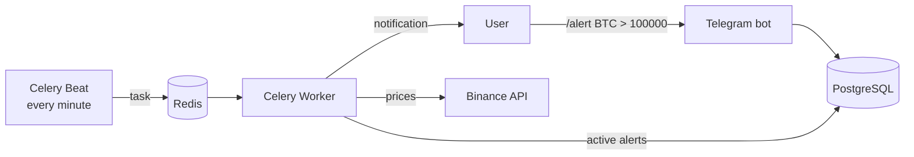

# Crypto Price Alerts

A Telegram bot that notifies you when a cryptocurrency reaches your target price.
Prices are checked every minute in the background with Celery.

Example: send `/alert BTC > 100000` — when Bitcoin goes above $100,000, the bot sends you a message.

## Features

- Telegram bot built with aiogram 3
- Create, list and delete price alerts (above or below a target price)
- Background price checks every minute with Celery Beat + Celery Worker
- Prices from the Binance public API, one request per coin (not per alert)
- Exact prices with `Decimal` / `Numeric` — no floating-point errors
- Input validation: wrong format, unknown coin, invalid or negative price
- Async SQLAlchemy with PostgreSQL, migrations with Alembic
- Unit tests with pytest
- Runs with one command using Docker Compose

## Tech stack

- Python, aiogram 3
- Celery, Redis
- PostgreSQL, SQLAlchemy (async), Alembic
- httpx (Binance API)
- pydantic-settings
- pytest
- Docker, Docker Compose

## How it works



1. The user creates an alert in the bot. The alert is saved to PostgreSQL.
2. Every minute Celery Beat puts a task into the Redis queue.
3. Celery Worker takes the task, loads active alerts and gets current prices from Binance.
4. If the condition is met, the alert is deactivated and the user gets a Telegram message.

## Bot commands

| Command | Description |
|---------|-------------|
| `/start` | Register |
| `/alert BTC > 100000` | Notify when the price goes above the target |
| `/alert ETH < 2500` | Notify when the price goes below the target |
| `/list` | Show your active alerts |
| `/delete 1` | Delete an alert by its number from `/list` |

## Getting started

1. Clone the repository and go to the project folder.

2. Create a bot with [@BotFather](https://t.me/BotFather) in Telegram and copy its token.

3. Create a `.env` file from the example and fill in your values (including `TELEGRAM_BOT_TOKEN`):

   ```bash
   cp .env.example .env
   ```

4. Start everything:

   ```bash
   docker compose up --build -d
   ```

   This starts five containers: `db`, `redis`, `bot`, `worker` and `beat`.
   Migrations are applied automatically when the bot starts.

5. Open your bot in Telegram and send `/start`.

Useful commands:

```bash
docker compose logs worker -f   # follow the worker logs
docker compose stop             # stop everything (data is kept)
```

## Running tests

```bash
python -m venv venv
source venv/bin/activate
pip install -r requirements.txt
pytest -v
```

## Project structure

```text
crypto-alerts/
├── app/
│   ├── bot/            # Telegram bot (commands)
│   ├── core/           # settings
│   ├── db/             # database session
│   ├── models/         # SQLAlchemy models: users, alerts
│   ├── repositories/   # database queries
│   ├── services/       # Binance client, alert parser, alert checker, notifier
│   └── worker/         # Celery app and periodic task
├── alembic/            # database migrations
├── tests/              # pytest tests
├── docker-compose.yml
├── Dockerfile
└── requirements.txt
```


## AI alerts from plain text

The bot sends your message and current draft to Ollama. The model returns the trading pair, direction, and target price as JSON. The bot asks for missing details and saves the alert when you click **Create**. Use `/cancel` to clear the draft. Drafts live in memory and are cleared when the bot restarts.

1. Start Ollama and download a model that supports structured JSON, such as `ollama pull qwen2.5:3b`.
2. Add `OLLAMA_MODEL=qwen2.5:3b` to `.env`. For a local Python process, the default address is `http://localhost:11434` and can be overridden with `OLLAMA_BASE_URL`. Docker Compose defaults to `http://host.docker.internal:11434` and uses `OLLAMA_DOCKER_BASE_URL` as its override. The address must be reachable by the bot.
3. Restart the bot. In a private chat, send `/start`, then “Notify me if ETH goes up”, then “3500”. The bot should preview `ETHUSDT > 3500`.

If `OLLAMA_MODEL` is empty, you can still create alerts with `/alert`.
